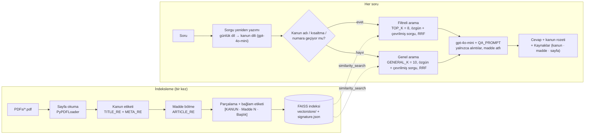

# Hukuk Asistan Chatbot

Kanun ve yönetmelik metinlerine (mevzuat PDF'leri) dayalı, RAG (Retrieval Augmented Generation) yöntemiyle çalışan Türkçe hukuk bilgi asistanı. Her cevap yalnızca yüklü mevzuata dayanır ve **kanun adı + madde numarası** atfı taşır. Streamlit arayüzü, LangChain, FAISS ve OpenAI modelleri kullanır.

*A Turkish RAG chatbot that answers questions from Turkish statutes and regulations (PDF) with article-level citations, built with Streamlit, LangChain, FAISS and OpenAI.*

> Bu uygulama hukuki tavsiye vermez; bilgi amaçlıdır. Kesin değerlendirme için bir avukata danışın.

## Özellikler

- **Kanun ve madde etiketleme:** Her PDF sayfası başlığından kanun adı ve numarası çıkarılır (`İŞ KANUNU`, `4857`); metin **madde sınırlarından** bölünür (`Madde 17 –`, `Ek Madde`, `Geçici Madde`), madde başlığı (`Süreli fesih`) ve mülga işareti metadata'ya yazılır.
- **Bağlam etiketli parçalar:** Her parça `[KANUN | Madde N | Başlık]` ön ekiyle indekslenir; kaynak gösterimi madde düzeyindedir.
- **Soru yönlendirme:** Soruda geçen kanun adı, kısaltma (`KVKK`, `TBK`, `TKHK`) veya numara (`4857 sayılı`) algılanır ve arama o kanunla sınırlanır; takip soruları kanunu sohbet bağlamından alır; somut durum soruları ("İşten çıkarıldım, haklarım neler?") tüm mevzuatta aranır.
- **Sorgu yeniden yazımı:** Günlük dildeki soru kısa bir LLM çağrısıyla kanun diline çevrilir ("ihbar süresi" → "bildirim süresi"); özgün soru ve çeviri ayrı aranır, sonuçlar Reciprocal Rank Fusion ile birleştirilir. Kullanılan sorgu "Kaynaklar" altında gösterilir; `QUERY_REWRITE = False` ile kapatılabilir.
- **Kaynaklı cevap:** `İŞ KANUNU · Madde 17, Madde 18 · s. 12` biçiminde kaynak listesi; kanun rozeti.
- **Kalıcı indeks:** FAISS indeksi bir kez kurulur (`vectorstore/`), PDF değişince imza dosyasıyla otomatik yenilenir.
- **Mobil uyumlu sohbet arayüzü:** karşılama kartı, örnek sorular, sohbeti temizleme, yüklü mevzuat listesi.
- **Tez için ölçüm araçları:** Kanun@k, Madde@k, MRR; parçalama / filtre / embedding / k ablasyonu; atıf doğruluğu ve halüsinasyon oranı (RAG ile salt LLM karşılaştırması); insan değerlendirme protokolü; her soruda tüm PDF'i okuyan karşılaştırma tabanı.

## Mimari



## 1. Mevzuat PDF'lerini ekleyin

1. <https://www.mevzuat.gov.tr> adresinde kanunu arayın ve sayfanın üstündeki **PDF** simgesinden indirin (yönetmelikler için aynı site veya Resmî Gazete).
2. Dosyaları `PDFs/` klasörüne koyun. İki düzen de desteklenir: tek birleştirilmiş dosya (`PDFs/Mevzuat.pdf`) **veya** kanun başına bir dosya (`PDFs/4857_Is_Kanunu.pdf`). Klasördeki tüm `.pdf` dosyaları okunur.
3. Etiketlemeyi kontrol edin (OpenAI çağrısı yapmaz):

```bash
python tools/inspect_pdf.py
```

Çıktıda her kanun için numara, sayfa aralığı, madde ve mülga sayısı listelenir. `Bilinmiyor` satırı varsa o sayfalarda künye (Kanun Numarası / Resmî Gazete) veya büyük harfli başlık algılanmamıştır; `HukukAsistan.py` içindeki `TITLE_RE` ve `META_RE` desenlerine bakın.

Tez kapsamı için önerilen başlangıç seti: 4857 İş Kanunu, 6098 Türk Borçlar Kanunu (kira hükümleri), 6502 Tüketicinin Korunması Hakkında Kanun, 6698 Kişisel Verilerin Korunması Kanunu.

## 2. Kurulum

Python 3.12 önerilir.

```bash
python -m venv .venv
.venv\Scripts\activate          # Windows (Linux/macOS: source .venv/bin/activate)
pip install -r requirements.txt  # birebir aynı sürümler için: pip install -r requirements.lock.txt
```

Proje klasöründe `.env` dosyası oluşturup OpenAI anahtarınızı yazın (örnek için `.env.example`):

```
OPENAI_API_KEY=sk-...
```

## 3. Çalıştırma

```bash
streamlit run HukukAsistan.py
```

İlk çalıştırmada PDF'ler okunup indeks kurulur (yüzlerce sayfa için 1–2 dakika); sonraki açılışlarda indeks diskten yüklenir. İndeksi uygulamayı açmadan kurmak için `python tools/build_index.py` kullanılabilir.

Telefondan denemek için sunucuyu yerel ağa açın ve bilgisayarın IP adresini kullanın (aynı Wi-Fi, güvenlik duvarı izni gerekir):

```bash
streamlit run HukukAsistan.py --server.address 0.0.0.0 --server.port 8502
```

## 4. Değerlendirme ve deneyler

Soru dosyası biçimi (`eval/questions.example.json`):

```json
[{"question": "2 yıl çalışan bir işçinin ihbar süresi ne kadardır?", "law": "İŞ KANUNU", "madde": [17]}]
```

`law` doğru kanun adının bir parçasıdır (büyük/küçük harf önemsiz), `madde` doğru madde numaralarıdır. Kendi altın setinizi `eval/questions.json` olarak kaydedin (kaynak önerisi: bakanlık ve KVKK Kurumu SSS sayfaları, tüketici hakem heyeti kararları, sınav soruları).

| Komut | Ölçtüğü | LLM çağrısı |
|---|---|---|
| `python tools/evaluate.py eval/questions.json --k 5` | Kanun@k, Madde@k, MRR (geri getirim) | Yok |
| `python tools/experiments.py eval/questions.json --k 1,3,5,10 --embeddings text-embedding-3-small,text-embedding-3-large` | Madde tabanlı vs sabit boyutlu parçalama, filtreli vs filtresiz arama, embedding modeli, k taraması → `eval/experiments.md` | Yok |
| `python tools/answer_eval.py eval/questions.json --judge` | Atıf doğruluğu, desteksiz atıf (halüsinasyon) oranı, RAG vs salt LLM, model tabanlı sadakat puanı → `eval/answers.json` | Soru başına 3 |
| `python tools/baseline_naive.py "soru"` | Her soruda tüm PDF'i okuyan, etiketsiz ve filtresiz tabanın cevabı ve adım süreleri | 1 + embedding |
| `eval/INSAN_DEGERLENDIRME.md` | İnsan değerlendirme protokolü (5 ölçütlü Likert, kör değerlendirme, kappa) | — |

## Proje yapısı

```
HukukAsistanChatbot/
├─ HukukAsistan.py            # uygulama: indeksleme, arama, arayüz (ayarlar dosyanın başında)
├─ PDFs/                      # mevzuat PDF'leri (README.md: ekleme talimatı)
├─ vectorstore/               # FAISS indeksi + signature.json (otomatik, git dışı)
├─ tools/
│  ├─ inspect_pdf.py          # kanun / madde etiketleme kontrolü
│  ├─ build_index.py          # indeksi komut satırından kur
│  ├─ evaluate.py             # Kanun@k, Madde@k, MRR
│  ├─ experiments.py          # ablasyon deneyleri
│  ├─ answer_eval.py          # atıf doğruluğu, halüsinasyon, RAG vs LLM, judge
│  └─ baseline_naive.py       # karşılaştırma tabanı
├─ eval/
│  ├─ questions.example.json  # soru seti şeması ve örnekler
│  └─ INSAN_DEGERLENDIRME.md  # insan değerlendirme protokolü
├─ requirements.txt / requirements.lock.txt
└─ .env.example               # OPENAI_API_KEY=sk-...
```

## Ayarlar

`HukukAsistan.py` başındaki sabitler: `PDF_DIR`, `INDEX_DIR`, `INDEX_VERSION` (parçalama mantığı değişince artırın), `CHUNK_SIZE` / `CHUNK_OVERLAP` (600 / 80), `TOP_K` (8), `GENERAL_K` (10), `QUERY_REWRITE` (sorgu yeniden yazımı), `RRF_K` (60), `EMBEDDING_MODEL`, `CHAT_MODEL`, `LAW_ALIASES` (kısaltmalar), `EXAMPLE_QUESTIONS`. Ortam değişkenleri `HUKUK_PDF_DIR` ve `HUKUK_INDEX_DIR` klasörleri geçici olarak değiştirir (test için).

Bu depodaki `PDFs/` klasöründe mevzuat.gov.tr'den alınan üç resmi metin bulunur: 4857 İş Kanunu, 6502 Tüketicinin Korunması Hakkında Kanun, 6698 Kişisel Verilerin Korunması Kanunu. Kira hükümleri için 6098 sayılı Türk Borçlar Kanunu PDF'inin aynı klasöre eklenmesi önerilir (`eval/questions.example.json` içindeki kira sorusu bu metni bekler).

| Görev | Model |
|---|---|
| Sohbet | `gpt-4o-mini` |
| Embedding | `text-embedding-3-small` (istek başına 200 parça) |

## Veri kaynağı ve telif

Kanun ve yönetmelik metinleri Cumhurbaşkanlığı Mevzuat Bilgi Sistemi'nden (mevzuat.gov.tr) alınır. 5846 sayılı Fikir ve Sanat Eserleri Kanunu'nun 31. maddesine göre resmen yayımlanan kanun, tüzük, yönetmelik, tebliğ, genelge ve yargı kararlarının çoğaltılması, yayılması ve işlenmesi serbesttir; bu nedenle metinlerin indekslenmesi ve alıntılanması telif engeline takılmaz. Metinlerin güncelliği indirme tarihine bağlıdır; mülga ve değişik maddeler metinde işaretli olduğu biçimiyle okunur.

## Tez planı ile eşleme

| Plan maddesi | Projedeki karşılığı |
|---|---|
| PDF yapı analizi betiği | `tools/inspect_pdf.py` |
| Her soruda tüm PDF'i okuyan basit prototip (karşılaştırma tabanı) | `tools/baseline_naive.py` |
| Kanun/madde etiketleme, Türkçe harf katlama, mülga işareti | `load_pages`, `_segment_articles`, `_fold` |
| Madde tabanlı parçalama + bağlam etiketi | `build_chunks` |
| Kalıcı FAISS indeksi, imza, toplu embedding | `load_or_build_index`, `_index_signature`, `_make_embeddings` |
| Soru yönlendirme (ad, kısaltma, numara; filtreli / genel / takip) | `detect_laws`, `is_situation_question`, `MevzuatRetriever`, `create_answer` |
| Prompt tasarımı | `QA_PROMPT` |
| Sohbet arayüzü, mobil uyum | `main`, `CSS` |
| Altın veri seti şeması | `eval/questions.example.json` |
| Recall@k, MRR | `tools/evaluate.py` |
| Atıf doğruluğu, halüsinasyon oranı, model tabanlı değerlendirme | `tools/answer_eval.py` |
| İnsan değerlendirme protokolü | `eval/INSAN_DEGERLENDIRME.md` |
| Deneyler: parçalama, filtre, embedding, k | `tools/experiments.py` |
| Dokümantasyon, mimari diyagram, sürüm etiketi | bu README, `git tag v0.1.0` |

## Sınırlamalar ve yol haritası

- Kanun başlığı ve madde algılama mevzuat.gov.tr düzenine göre ayarlanmıştır; farklı düzenlerde `TITLE_RE` / `ARTICLE_RE` güncellenmelidir (`tools/inspect_pdf.py` ile doğrulayın).
- Değişik ve mülga maddeler yalnızca işaretlenir; yürürlük tarihine duyarlı arama (zamana duyarlı RAG) gelecek çalışmadır.
- Arama yalnızca yoğun vektör aramasıdır; BM25 ile hibrit arama deney olarak eklenebilir.
- İçtihat (Yargıtay, Danıştay, AYM kararları) kapsam dışıdır.
- Taranmış (görüntü) PDF'lerden metin çıkarılamaz; OCR gerekir.

## Uyarı

Bu uygulama yalnızca yüklü mevzuat metnindeki bilgiyi aktarır; hukuki tavsiye yerine geçmez. Süre kaçırma riski olan işlemler için bir avukata ya da baroların adli yardım bürosuna başvurun.
